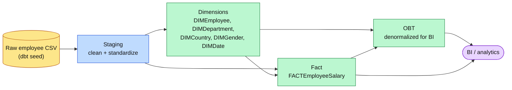
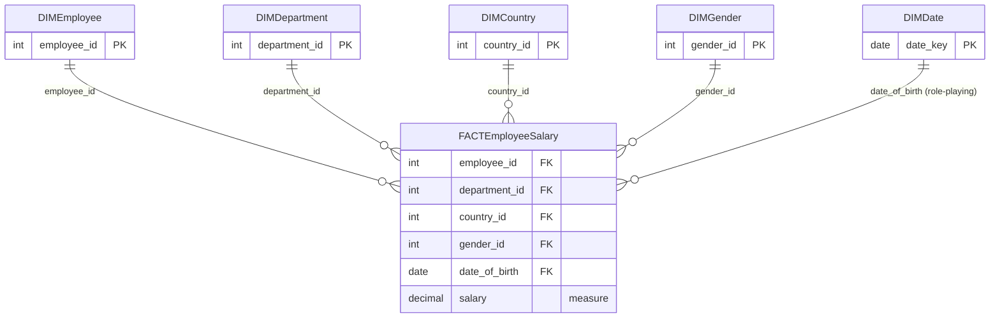
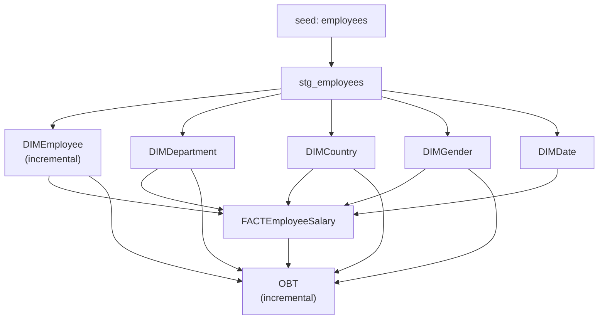

# Employee Data Warehouse | dbt & SQL Server

A dimensional data warehouse built with **dbt Core** on **Microsoft SQL Server**. It turns a raw employee dataset into a star schema (plus a denormalized OBT) ready for reporting and analytics.

## Table of contents

- [Tech stack](#tech-stack)
- [Architecture](#architecture)
- [Star schema](#star-schema)
- [Data lineage](#data-lineage)
- [Data model](#data-model)
- [Data quality](#data-quality)
- [Incremental strategy](#incremental-strategy)
- [Getting started](#getting-started)
- [Documentation](#documentation)
- [Project structure](#project-structure)
- [Architecture Documentation](#architecture-documentation)
- [Known limitations](#known-limitations)
- [Roadmap](#roadmap)

## Tech stack

| Layer | Tool |
|---|---|
| Warehouse | Microsoft SQL Server |
| Transformation | dbt Core (`dbt-sqlserver` adapter) |
| Language | SQL (T-SQL), Jinja |
| Environment | Python managed with `uv` |
| Version control / CI | Git, GitHub, GitHub Actions |

## Architecture



| Layer | Purpose |
|---|---|
| **Seed** | Loads the employee dataset. |
| **Staging** | Standardizes source data (types, names, trimming) for downstream models. |
| **Dimensions** | Employee, department, country, gender and date attributes. |
| **Fact** | `FACTEmployeeSalary` – salary measure plus dimension keys. |
| **OBT** | One Big Table: dimensions joined to the fact for easy analytics. |

## Star schema



> Only keys are shown. Descriptive attributes of each dimension are documented in `dbt docs`.

## Data lineage



Run `dbt docs generate && dbt docs serve` for the interactive, always-up-to-date lineage graph.

## Data model

### Dimensions

`DIMEmployee`, `DIMDepartment`, `DIMCountry`, `DIMGender`, `DIMDate`

### Fact

`FACTEmployeeSalary`

- **Grain:** one row per employee in the current dataset.
- **Measures:** `salary` (additive across employees, non-additive over time).
- **Keys:** employee, department, country, gender, date of birth.

> The source has no salary effective dates or history, so this model represents current salary data, not salary changes over time.

## Data quality

dbt tests validate:

- `not_null` on keys and salary
- `unique` on employee identifiers and dimension keys
- `relationships` between fact and dimension keys
- salary validation (positive values)

Current dataset: **3,000** employees. The fact build and its 9 tests pass.

Source-to-fact reconciliation:

| Metric | Staging | Fact |
|---|--:|--:|
| Row count | 3,000 | 3,000 |
| Total salary | 19,352,774.90 | 19,352,774.90 |

## Incremental strategy

`DIMEmployee` and `OBT` are incremental and insert **new** employee IDs only. Changes to existing employees are not captured yet (see [Roadmap](#roadmap)).

## Getting started

```bash
# 1. install dependencies
uv sync                 # or: uv add dbt-core dbt-sqlserver

# 2. configure the `depi_dbt` profile in ~/.dbt/profiles.yml
#    (never commit credentials)

# 3. install dbt packages
uv run dbt deps

# 4. verify the connection and build everything
uv run dbt debug
uv run dbt build
```

## Documentation

```bash
uv run dbt docs generate
uv run dbt docs serve --port 8081   # http://localhost:8081
```

More detail: [`docs/architecture.md`](docs/architecture.md).

## Project structure

```text
.
├── analyses/        ad-hoc analytical queries
├── macros/          reusable Jinja/SQL
├── models/
│   ├── staging/     cleaned source data
│   └── marts/       dimensions, fact, OBT
├── seeds/           raw employee dataset
├── snapshots/       history tracking (SCD2)
├── tests/           singular data tests
├── .github/workflows/  CI
├── docs/            architecture notes
└── dbt_project.yml
```


## Architecture Documentation

For a detailed explanation of the project architecture, data flow, dimensional modeling, data quality strategy, design decisions, and recommended improvements, see the [Architecture & Design Notes](docs/architecture.md).

## Known limitations

- No salary history (no effective dates in the source).
- Incremental models do not pick up updates to existing employees.
- Data is loaded from a seed rather than a real source system.

## Roadmap

- [ ] Track attribute changes with an SCD Type 2 snapshot on `DIMEmployee`
- [ ] Switch incremental models to `unique_key` + `merge`/`delete+insert`
- [ ] Add an "Unknown" member (-1) to each dimension
- [ ] Generate `DIMDate` with `dbt_utils.date_spine`
- [ ] Surrogate keys via `dbt_utils.generate_surrogate_key`
- [ ] Source freshness and richer data-quality monitoring
- [ ] Scheduling (dbt Cloud, Airflow, or SQL Agent)
