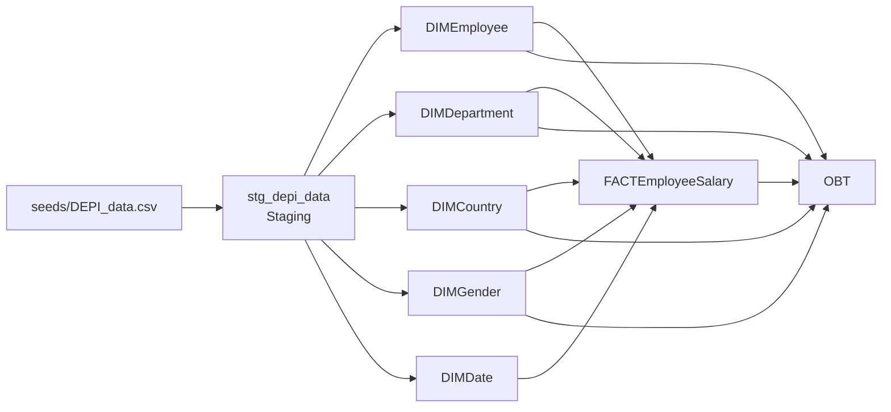
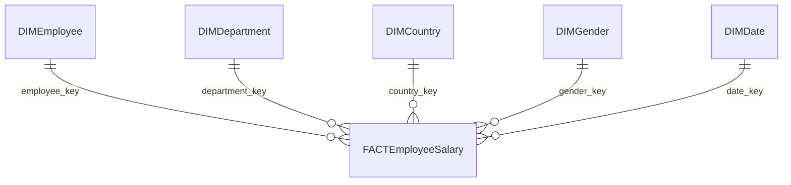

# Architecture & Design Notes

## 1. Project Overview

This project implements an employee data warehouse using dbt Core and Microsoft SQL Server.

The project transforms the `DEPI_data.csv` seed into staging models, dimensional models, a fact table, and an analytical One Big Table (OBT).

The design focuses on data transformation, dimensional modeling, data quality testing, and reusable SQL logic.

## 2. Current Architecture

### Model Responsibilities

| Model | Responsibility |
|---|---|
| `stg_depi_data` | Prepare and standardize source data for downstream models. |
| `DIMEmployee` | Represent employee-level descriptive attributes. |
| `DIMDepartment` | Represent department attributes. |
| `DIMCountry` | Represent country attributes. |
| `DIMGender` | Represent gender attributes. |
| `DIMDate` | Provide calendar-related attributes. |
| `FACTEmployeeSalary` | Store employee salary facts and the keys needed to connect dimensions. |
| `OBT` | Combine fact and dimension data into a denormalized analytical model. |

The diagram represents the intended data lineage. Verify SQL dependencies and materialization settings before treating every relationship as a confirmed implementation detail.

## 3. Dimensional Modeling

### Star Schema

The central fact model is `FACTEmployeeSalary`, surrounded by employee, department, country, gender, and date dimensions.

### Fact Grain

The intended grain is one row per employee in the current dataset snapshot.

This grain must remain consistent across the fact model. If the source later contains multiple salary records per employee over time, the grain must be redesigned to represent a salary event or an employee salary period.

### Measures and Descriptive Attributes

Salary is the main measure in the current analytical model.

Employee characteristics such as date of birth, gender, country, and department are descriptive attributes and generally belong in dimensions rather than being unnecessarily duplicated in the fact.

## 4. Current Design Considerations

### Surrogate Keys

The project includes a custom macro in `macros/surrogate_key.sql` for generating surrogate keys.

Surrogate keys help provide dimensional identifiers and avoid relying entirely on source-system identifiers.

The macro's implementation and null-handling behavior should be reviewed before assuming it is equivalent to any external dbt package.

### Data Quality

The project includes schema tests and custom SQL tests, including:

- `negative_salary.sql`
- `salary_in_range.sql`
- `reconcile_obt_to_fact.sql`
- `reconcile_staging_to_fact.sql`

These tests help validate salary constraints and consistency between transformation layers.

Test coverage should also be reviewed for primary keys, required attributes, and foreign-key relationships across all dimensions.

### Analytical Model

`OBT` provides a denormalized model for analytical queries.

It should be built from trusted downstream models, such as the fact and relevant dimensions, rather than independently reimplementing business logic against the raw seed.

## 5. Recommended Improvements

The following items are recommendations, not claims that the functionality has already been implemented.

### 5.1 Review the Date Dimension Relationship

Date of birth is a person attribute, not a business event date.

If the current fact uses `DIMDate` only to represent date of birth, consider keeping the birth date in `DIMEmployee` instead.

Add a genuine event date, such as hire date or salary effective date, when the source provides one and the business requirements support it.

### 5.2 Review Source Identifiers and Surrogate Keys

Use the existing custom surrogate-key macro consistently where appropriate.

Test behavior for null values, changed source identifiers, and duplicate business records before changing key logic.

### 5.3 Handle Source Updates Explicitly

If source records can change, decide how each model should handle updates.

Possible approaches include rebuilding a table, using a supported incremental strategy, or implementing Slowly Changing Dimension Type 2 (SCD Type 2) when historical attribute changes must be retained.

Incremental processing requires a reliable change-detection mechanism, such as an update timestamp or a hash of tracked attributes.

### 5.4 Add an Unknown Dimension Member Where Required

For dimensions that may not have a matching record, consider an explicit Unknown member and a consistent foreign-key fallback.

Define and test the convention before using a special key such as `-1`. Ensure the key data type and relationship tests support the design.

### 5.5 Improve Date Dimension Generation

Review how `DIMDate` is currently generated.

If a broader or more maintainable calendar is required, consider generating a date spine and adding useful attributes such as year, quarter, month, and week.

An external package is optional; evaluate compatibility with the current dbt SQL Server adapter before adding dependencies.

### 5.6 Standardize Naming Conventions

The current model names use names such as `DIMEmployee` and `FACTEmployeeSalary`.

For future growth, consider a consistent snake_case convention, for example:

- `dim_employee`
- `dim_department`
- `fct_employee_salary`
- `stg_depi_data`

Renaming is optional and should be done consistently across SQL files, YAML definitions, tests, and references.

### 5.7 Organize Models by Layer

Keep staging transformations separate from dimensional and analytical models.

Use `dbt_project.yml` to configure folder-level materializations where appropriate. Confirm the current configuration before changing it.

### 5.8 Define Data Lineage Clearly

The current project uses `seeds/DEPI_data.csv` as a seed input.

A dbt source definition is appropriate when the data is loaded into a database table managed outside dbt. A seed referenced by downstream models should normally be referenced with `ref()`.

Document the actual lineage instead of declaring a source solely to make the diagram look more complete.

### 5.9 Expand Analytical Attributes Carefully

Additional attributes, such as salary bands or age bands, can improve analysis when their definitions are documented and business-relevant.

Avoid duplicating derived logic across multiple models. Define shared business rules in a suitable upstream model or reusable macro.

### 5.10 Strengthen Test Coverage

Review and extend tests for:

- Unique and non-null dimension keys.
- Required business attributes.
- Valid salary ranges and accepted gender values.
- Fact-to-dimension relationships.
- Reconciliation between upstream and downstream models.

Use built-in dbt tests where possible and custom SQL tests where they express project-specific business rules more clearly.

## 6. Implementation Principles

- Keep each model's grain explicit.
- Separate staging logic from dimensional modeling.
- Keep business logic reusable and testable.
- Use incremental processing only when its change-detection behavior is reliable and has been tested.
- Preserve history only when the business requirements call for it.
- Document proposed changes separately from implemented features.
- Run the relevant dbt tests after every structural change.

## 7. Next Steps

A sensible implementation order is:

1. Verify model dependencies, materializations, and fact grain.
2. Review date-of-birth handling and the date dimension relationship.
3. Audit key generation and dimension-level tests.
4. Decide whether source updates require incremental processing or SCD2.
5. Standardize naming and folder conventions if the benefits justify the migration effort.
6. Update this document whenever an architectural change is implemented and tested.
